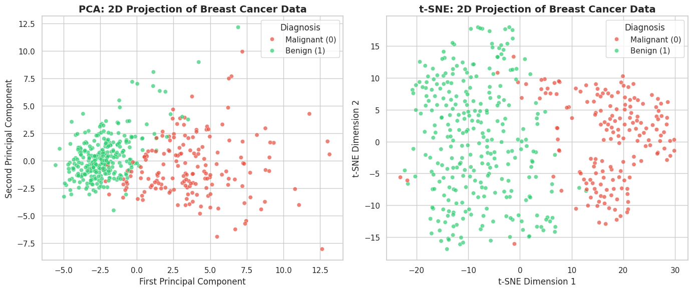
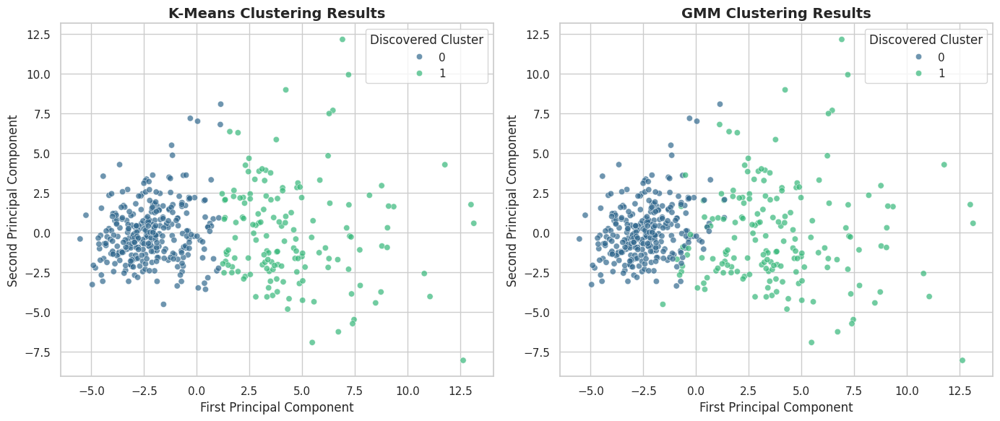
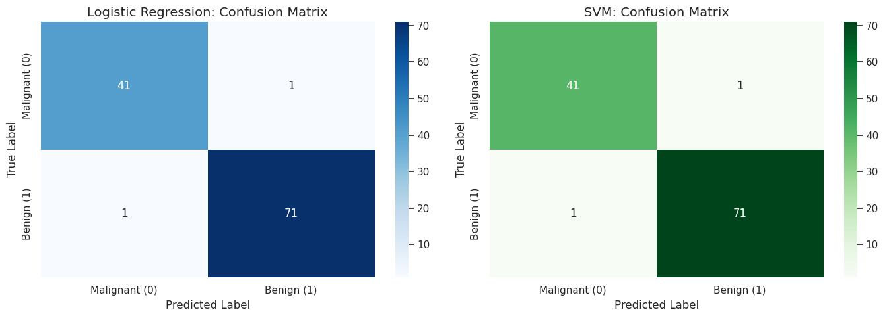
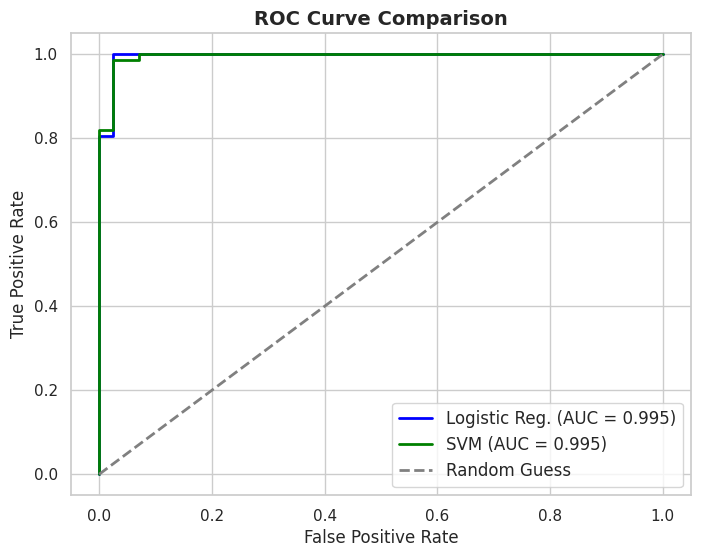
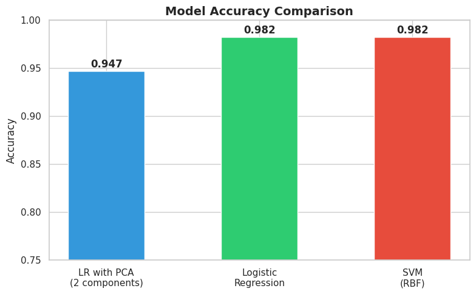

# Breast Cancer Classification — Machine Learning

**Supervised and unsupervised machine learning applied to the Breast Cancer Wisconsin (Diagnostic) dataset.**

Academic project by **Jon Rodriguez and Iker Elias** (May 2026), developed at Tecnun — University of Navarra.

## Project overview

This project investigates whether measurements of cell nuclei reveal natural distinctions between benign and malignant breast tumors, and how accurately classification models can predict the diagnosis **on this benchmark dataset**.

The study uses the [Breast Cancer Wisconsin (Diagnostic) dataset](https://scikit-learn.org/stable/modules/generated/sklearn.datasets.load_breast_cancer.html), accessed directly through scikit-learn: **569 samples**, **30 numerical features**, and two target classes (malignant and benign). A stratified 80/20 train/test split is used, with feature standardization fitted on the training data.

### Methods

- **Data preparation:** exploratory analysis, missing-value inspection, standardization, and stratified train/test splitting.
- **Unsupervised learning:** PCA, t-SNE, K-Means clustering, and Gaussian Mixture Models (GMM).
- **Supervised learning:** Logistic Regression and Support Vector Machine (SVM, RBF kernel).
- **Evaluation:** cross-validation, confusion matrices, precision, recall, F1-score, ROC/AUC analysis, and a reduced-feature PCA classifier.

## Main results

| Model | Test accuracy | Recall — malignant class |
|---|---:|---:|
| Logistic Regression (30 features) | **98.2%** | **97.6%** |
| SVM with RBF kernel (30 features) | **98.2%** | **97.6%** |
| Logistic Regression on 2 PCA components | **94.7%** | 95.2% |

Both full-feature supervised models correctly identified **41 of the 42 malignant samples** in the held-out test set. The 2-component PCA projection explains **63.36%** of the training-set variance.

These are results on one small academic benchmark with a single test split; they **do not establish clinical validity or readiness for medical use**.

## Visualizations

**Dimensionality reduction (PCA and t-SNE)**



**Clustering (K-Means and GMM)**



**Confusion matrices — supervised models**



**ROC curves**



**Test accuracy comparison**



## Repository structure

```text
breast_cancer_ml_github/
├── notebooks/
│   └── breast_cancer_analysis.ipynb
├── figures/
│   └── ... (original plots from the notebook)
├── report/
│   └── research_report.pdf
├── requirements.txt
└── README.md
```

## Run the notebook locally

```bash
python -m venv .venv
# Windows: .venv\Scripts\activate
# macOS/Linux: source .venv/bin/activate
pip install -r requirements.txt
jupyter notebook notebooks/breast_cancer_analysis.ipynb
```

The dataset is loaded from `sklearn.datasets.load_breast_cancer`; **no separate dataset download is required**.

## Notes on reproducibility

The notebook preserves the original analysis and its recorded outputs. A minor Seaborn plotting compatibility change was applied to the class-distribution chart; the machine learning methods and evaluation remain unchanged. Re-running with different library versions may produce slightly different visualizations or model outputs.

## Limitations

- Small, single-source benchmark dataset with 114 held-out test observations.
- No external clinical validation or prospective testing.
- Models are not designed for real patient diagnosis.
- Hyperparameters were not systematically optimized.
- To improve cross-validation hygiene, future versions should fit scaling within each cross-validation fold (e.g., with scikit-learn `Pipeline`).

For detailed methodology and interpretation, see [the full research report](report/research_report.pdf).
